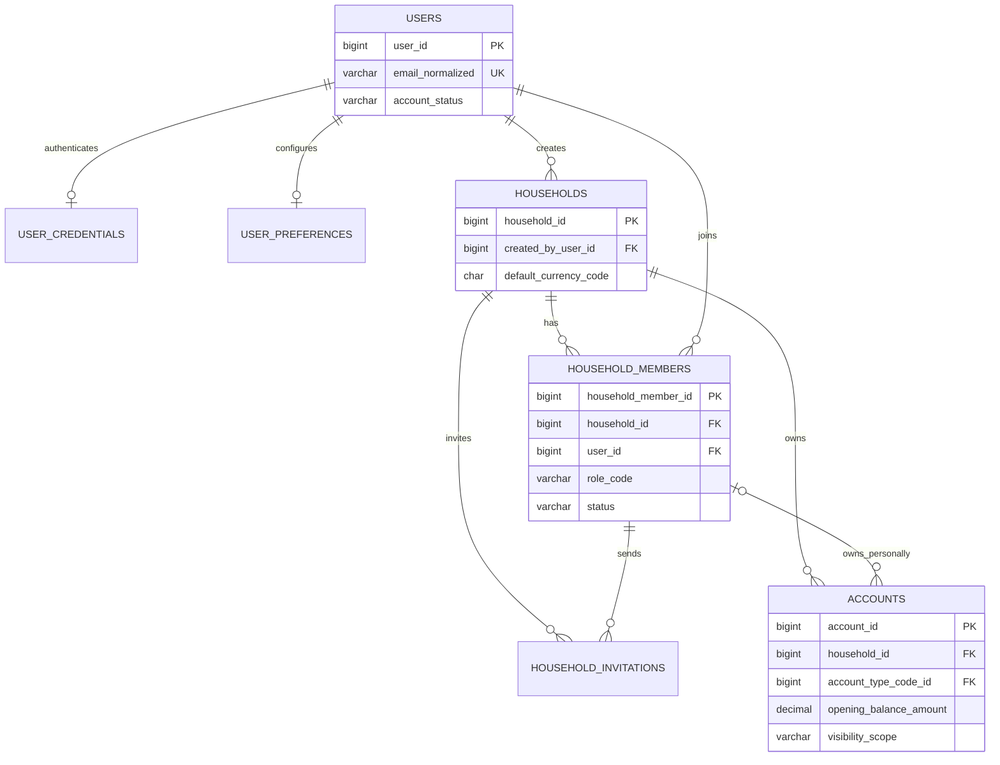
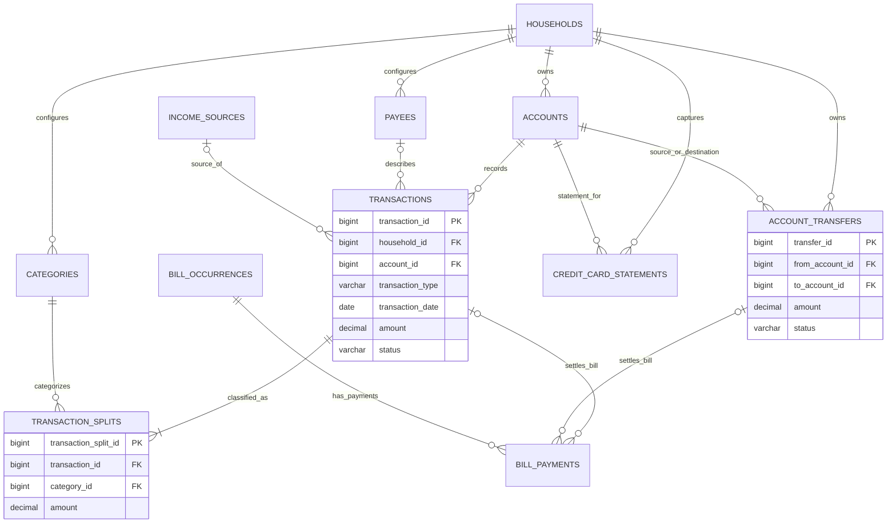
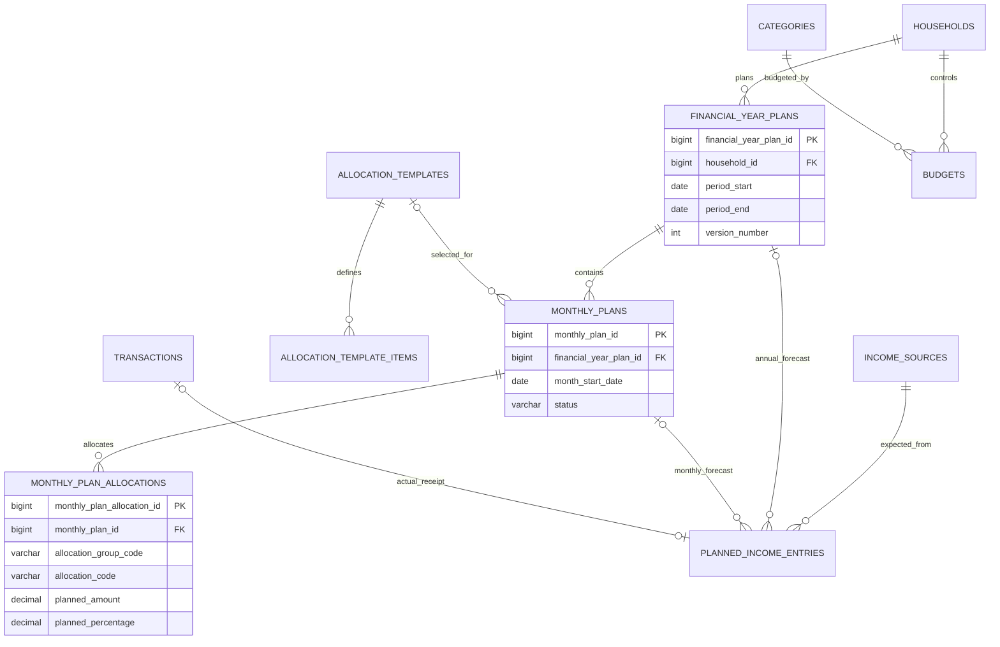
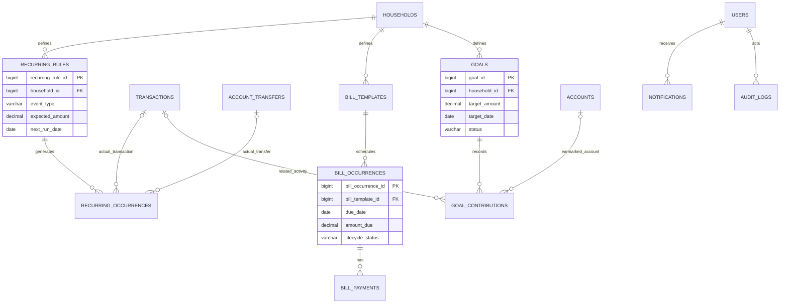

# Database ERD — Review Draft

These Mermaid diagrams show the principal relationships, not every operational FK. They are intentionally split by domain so that each diagram remains reviewable. A rendered ERD should be generated again after table/constraint approval.

## 1. Identity, household and access

## 2. Actual money events

## 3. Yearly, monthly and allocation planning

## 4. Recurring commitments, bills and goals

## Notes for the reviewer

- Mermaid's compact syntax does not display every composite FK or cross-row service validation.
- Generic catalog relationships, `credit_card_details`, `user_credentials`, `user_preferences`, `audit_logs` and some operational fields are omitted from the drawing for readability; they remain in `DATABASE_DESIGN.md`.
- The detailed database dictionary is authoritative for proposed field/type names; both artifacts must be changed together when a decision changes.
